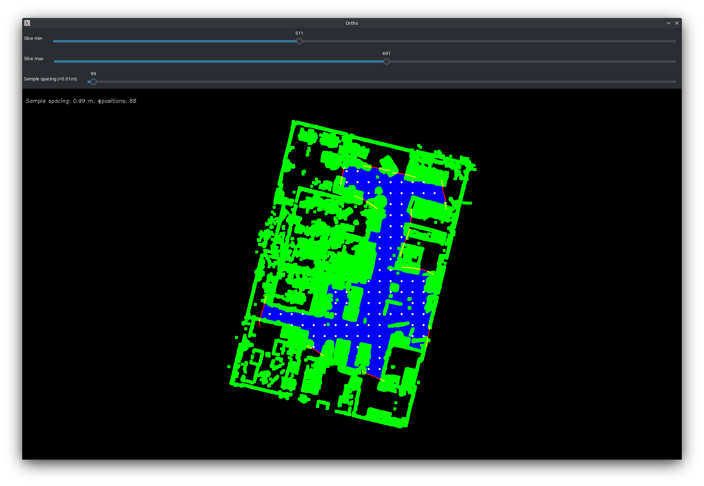

# Tutorial

## Installation

Follow the install instructions provided in the repository.

## Execution
### Files

Download the example tutorial files [here](https://drive.google.com/drive/folders/1599vzEu5NuNpv_ZTwHtLWl9omHaxZ_4p?usp=sharing). It includes everything you need to run the application.
You now should have an `.e57` point cloud, an `.avi` test video and `.txt` camera intrinsics file. Optionally, you also have a ORB vocabulary, only needed for SLAM in the Prebuild and Localize approach.
Make sure these files are in the same folder before running the program.
To run the program you will need to know the path to your folder with the files, both an absolute path and relative path to the folder will work.

### Generate models

Before running the program you will need to generate 2 models using a python script included with the RTRenderer. Go to the model folder in the renderer project, and edit the export_ts.py file. First put for H (height) and  W (width) both 1440, save and run the script. Next change the H to 720 and the W to 1280, save and run the script.

It is possible the script takes a while to complete.

### Run Render & Match

Execute this command:
```
render_match {path_to_folder} pcl_FM_Leuven_Lab_Drivetrain.e57 vid_FM_Leuven_Lab_Drivetrain.avi camera_intrinsics.txt
```

You will see a window pop up with some sliders and a top view of the point cloud. This window allows you to sample camera poses inside the point cloud.

#### Other commands

You can find more info in the `README.md` to run other versions of this program.

#### UI and controls:

- **[Slider]** Slice min: The minimum height of the point cloud that is being used. Usually you can find the layer where the ground is just not visible in the view, so one layer above the ground.
- **[Slider]** Slice max: The maximum height of the point cloud that is being used. For this you can take the value of the "Slice min" and add around 1.50 to it. This represent the height of the camera to the ground plane. 
- **[Slider]** Sample spacing: The distance between sample positions. This depends on the size of the point cloud. Having too much sample positions will decrease the performance, having a low amount of sample positions will cause the map to be too sparse for relocalization.

- **[Keyboard]** d: dilate, thickens the the green points of the point cloud.
- **[Keyboard]** s: confirm the sample positions of that will be used to build the slam map.
- **[Keyboard]** r: reset the point cloud modifications, does NOT reset the slider values.

- **[Mouse]** Left click + drag: draw red lines to close areas off for sampling.
- **[Mouse]** Right click: mark an area for sampling, the area turns blue.

#### Follow these steps for a working example:

1. Put "Slice min" to 511 (-1.30).
2. Put "Slice max" to 691 (0.50).
3. Press "d" on your keyboard 3 times to dilate the point cloud.
4. Close the gaps in the point cloud by drawing the red lines (example shown in the image below).
5. Mark the inner area for sampling. If there is still a gap the blue will escape the marked area, you will have to restart from step 3 by pressing "r".
6. Put "Sample spacing (x0.01m)" to around 150.
7. Press "s" on your keyboard to confirm the sampling.
8. Press "q" to close the window and build the slam map.
9. Wait for the map to be build, a video will start playing once the process is complete.
10. After the video the program will close.
11. The trajectory is saved to a file called `{path_to_folder}/estimated/vid_FM_Leuven_Lab_Drivetrain_rm.txt`



### Run Prebuild & Localize

Execute this command:
```
prebuild_map {path_to_folder} pcl_FM_Leuven_Lab_Drivetrain.e57 vid_FM_Leuven_Lab_Drivetrain.avi camera_intrinsics.txt
```

You will see a window pop up with some sliders and a top view of the point cloud. This window allows you to sample camera poses within the point cloud. Follow the instructions above, but set sample spacing to a smaller value (e.g. 50-75) corresponding to a denser SLAM map. At each of the white points keyframes will be created. A value that is too small will result in very dense SLAM map reducing tracking frequency and relocalization performance, too high and relocalization will not work, or tracking may be lost easily.

Once the map has been built, run the following command for tracking in the map:
```
localize_video {path_to_prebuild_localize_installation}/stella_config/orb_vocab.fbow {path_to_prebuild_localize_installation}/stella_config/config.yaml {path_to_folder} vid_FM_Leuven_Lab_Drivetrain.avi camera_intrinsics.txt prebuild.msg
```
The trajectory is saved to a file called `{path_to_folder}/estimated/vid_FM_Leuven_Lab_Drivetrain_slam_prebuild.txt`.  

### Visualize localization with render_trajectory

For the trajectory generated by render_match, replace `{path_to_estimated_trajectory}` with `{path_to_folder}/estimated/vid_FM_Leuven_Lab_Drivetrain_rm.txt`.
For the trajectory generated by prebuild_localize, replace `{path_to_estimated_trajectory}` with `{path_to_folder}/estimated/vid_FM_Leuven_Lab_Drivetrain_slam_prebuild.txt`.

Run the following command:
```
render_trajectory {path_to_folder} pcl_FM_Leuven_Lab_Drivetrain.e57 vid_FM_Leuven_Lab_Drivetrain.avi camera_intrinsics.txt {path_to_estimated_trajectory}
```

This creates a new folder with rendered images, camera images and blended images in `{path_to_folder}/visualization`. 

